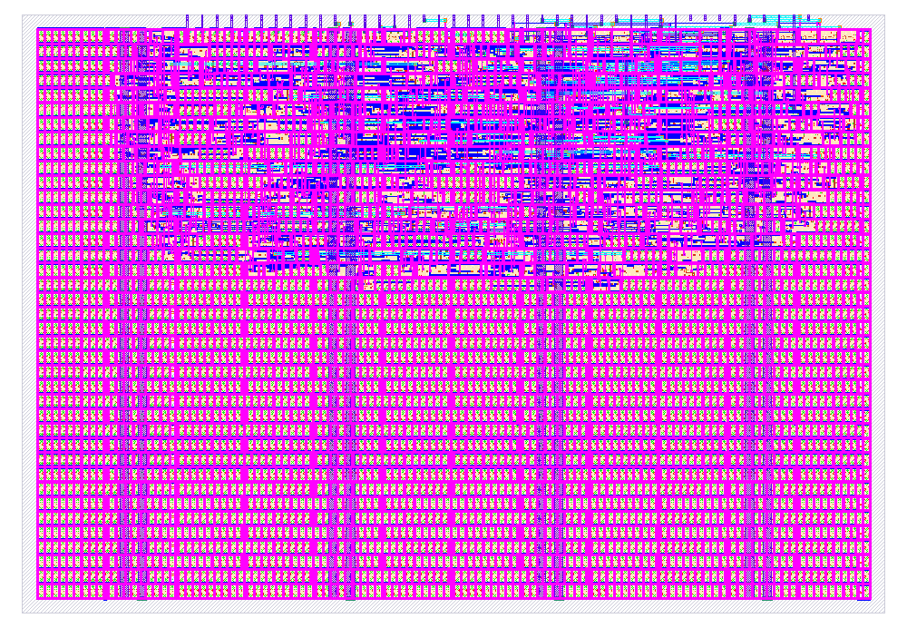

# TinyMAC — Tiny AI Hardware Accelerator

A digital ASIC project developed for [Tiny Tapeout](https://tinytapeout.com/).

## Overview

TinyMAC is a **4-bit Multiply-Accumulate (MAC) Accelerator** designed in SystemVerilog.

The circuit performs the following operation:

**ACC = ACC + (A × B)**

It supports signed 4-bit operands, a 16-bit saturating accumulator, bias loading, and basic control operations.

The goal is to design, simulate, verify, and implement a functional MAC accelerator in silicon.

## Project Structure

The design consists of three main modules:

- **`mac_datapath.sv`** — Performs multiplication, accumulation, and bias loading.
- **`mac_controller.sv`** — Controls operations using a Finite State Machine (FSM).
- **`mac_core.sv`** — Integrates the controller and datapath.

Additional files:

- **`project.v`** — Connects the MAC core to the Tiny Tapeout interface.
- **`test/`** — Contains testbenches and verification scripts.
- **`info.yaml`** — Defines the Tiny Tapeout project configuration.
- **`docs/`** — Contains the project documentation.
- **`results/`** — Contains simulation logs, waveforms, physical design reports, and submission files.

## Development & Verification

Each module was developed and tested independently before integration.

Verification includes:

- Functional simulation using SystemVerilog and cocotb.
- Arithmetic and FSM tests.
- Full system integration tests.
- ASIC synthesis and physical design using LibreLane.
- Gate-level simulation.
- DRC, LVS, and Tiny Tapeout Precheck.

### Verification Results

| Test | Result |
|---|---|
| Datapath | 12/12 passed |
| Controller | 10/10 passed |
| RTL Simulation | 9/9 passed |
| Gate-Level Simulation | 9/9 passed |
| Tiny Tapeout Precheck | 17/17 passed |
| DRC | 0 violations |
| LVS | Passed |

The design was implemented using the SKY130A PDK in a single Tiny Tapeout tile, with a target clock frequency of 50 MHz.

### Physical Design Results

| Parameter | Result |
|---|---|
| Technology | SKY130A (130 nm) |
| Tiles | 1x1 |
| Target Clock Frequency | 50 MHz |
| Clock Period | 20 ns |
| Utilization | 23.634% |
| Cell Count (excluding fill and tap cells) | 383 |
| Flip-Flops | 17 |
| Worst Setup Slack | +3.244 ns |
| Worst Hold Slack | +0.124 ns |
| Estimated Nominal Power | 438.16 uW |

All setup and hold timing checks passed. Max slew violations remain in the slow corner and are documented in the physical design results.

## Resources

- [Project Documentation](docs/info.md)
- [Interface Documentation](docs/interfaces.md)
- [Verification Results](docs/verification.md)
- [Physical Design Results](docs/physical_design.md)
- [Simulation Logs and Reports](results/)
- [Tiny Tapeout Submission](results/submission/tt_submission.zip)
- [Tiny Tapeout](https://tinytapeout.com/)
- [Tiny Tapeout Verilog Template](https://github.com/TinyTapeout/ttsky-verilog-template)
- [License](LICENSE)

---

**Status:** Implemented and verified.