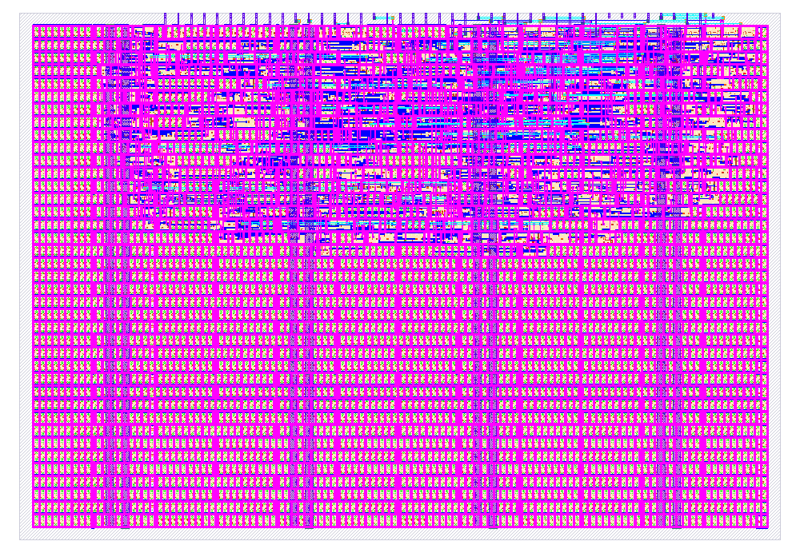

# Physical Design

## 1. GDS build

After the RTL tests passed, we used the Tiny Tapeout GitHub Actions workflow to synthesize the design and generate the layout with LibreLane. We used the SKY130A PDK and the `sky130_fd_sc_hd` standard-cell library.

The results on this page come from [build 079dc9a](https://github.com/ArchBsc/tinymac/actions/runs/45915750505). We saved the main reports and layout files in [`results/physical_design/`](../results/physical_design/).

## 2. Layout and area

| Parameter | Result |
| --- | ---: |
| Tiles | 1 x 1 |
| Dimensions | 161 x 111.52 µm |
| Die area | 17,954.7 µm² |
| Core area | 16,493.3 µm² |
| Cell area after synthesis | 3,311.93 µm² |
| Final cell area (including tap cells, excluding fill) | 4,126.46 µm² |
| Utilization (workflow summary) | 23.634% |
| Cells (excluding fill and tap cells) | 383 |
| Flip-flops | 17 |
| Routed wire length | 8,044 µm |

The 17 flip-flops are consistent with the 16-bit accumulator and the controller's two-state FSM.

Sources: [synthesis report](../results/physical_design/synthesis_stat.rpt) and [final metrics](../results/physical_design/metrics.json), along with the workflow summary.

## 3. Timing analysis

We set the clock period to 20 ns (50 MHz) and checked the final timing report. The table shows the worst setup and hold slack for each process corner across the three RC corners.

| Corner | Setup slack (ns) | Hold slack (ns) |
| --- | ---: | ---: |
| Fast (1.95 V, -40°C) | +11.1103 | +0.1235 |
| Typical (1.8 V, 25°C) | +9.6574 | +0.3489 |
| Slow (1.6 V, 100°C) | +3.2437 | +0.9639 |

All nine corners had zero setup and hold violations. This means that the design meets the 50 MHz target under the timing constraints used in the build.

We also found maximum transition (slew) violations at the slow corner: 33 at min RC, 55 at nominal RC and 66 at max RC. Some signals exceed the 0.75 ns transition limit. These warnings have not been fixed, even though setup and hold timing passes. No maximum capacitance violations were reported.

Sources: [STA summary](../results/physical_design/sta_summary.rpt), [worst setup path](../results/physical_design/worst_setup.rpt), [worst hold path](../results/physical_design/worst_hold.rpt) and [timing constraints](../results/physical_design/tt_um_archbsc_tinymac.sdc).

## 4. DRC, LVS and precheck

| Check | Result |
| --- | --- |
| Final routing DRC | 0 errors |
| Magic DRC | 0 errors |
| Netgen LVS | 0 errors |
| Antenna check | 0 violations |
| Tiny Tapeout Precheck | 17/17 passed |
| Gate-level simulation | 9/9 passed |

The LVS report confirms that the layout and netlist match. The separate Tiny Tapeout Precheck also passed its Magic and KLayout checks.

Sources: [DRC report](../results/physical_design/drc.magic.rpt), [LVS report](../results/physical_design/lvs.netgen.rpt), [antenna report](../results/physical_design/antenna_summary.rpt) and the GitHub Actions summary linked above.

## 5. Power estimation

We checked the OpenROAD power report at the typical corner (1.8 V, 25°C, nominal RC).

| Group | Estimated power |
| --- | ---: |
| Combinational logic | 336.73 µW |
| Sequential logic | 60.31 µW |
| Clock network | 41.11 µW |
| Total | 438.16 µW |

These values are estimates from the tool, not measurements from a fabricated chip. The same applies to the timing results: operation on real hardware still needs to be tested.

Source: [power report](../results/physical_design/power_nom_tt.rpt).
